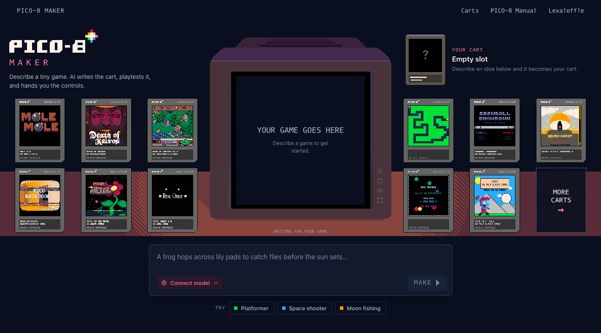

# PICO-8 Maker

**Turn a conversation into a playable PICO-8 game.**

Describe an idea, let the agent write and playtest it in WebAssembly, then refine it and export a `.p8` cartridge. Built with React, assistant-ui, Pi Durable Agent and [PICO-8 Player](https://github.com/boxuechen/pico8-player).

[](https://github.com/boxuechen/pico8-maker/actions/workflows/ci.yml)
[](LICENSE)

[Live demo](https://boxuechen.github.io/pico8-maker/) · [简体中文](README.zh-CN.md) · [Contributing](CONTRIBUTING.md)



## Use Maker

- Create and revise games through conversation, with tool activity and playable previews.
- Let the agent test inputs, inspect state and review captured frames in a separate session.
- Inspect code and resources, undo changes, compare versions and resume conversations.
- Export the latest committed game as a `.p8` cartridge.

Open the demo in **Chrome/Chromium**. Community cartridges need no model key. To create games, configure your own model endpoint and API key, then use **Test connection**. The provider must support tool calling, image input and browser requests from your origin (CORS); provider charges may apply. Use **STOP** to cancel a request and **SAVE CART** to export.

## Quick start

Use **Node.js 24.22.2** and npm. The first start downloads the pinned Player build; no player source checkout or Emscripten installation is needed.

```sh
git clone https://github.com/boxuechen/pico8-maker.git
cd pico8-maker
npm --prefix app ci
npm --prefix app run dev -- --host 127.0.0.1 --port 5175
```

Open [localhost:5175](http://127.0.0.1:5175). For tests, deployment and Player updates, see the [development guide](docs/development.md).

## Data and model access

Carts, versions and conversations stay in browser IndexedDB. Model settings, including the API key, are saved in localStorage by default; you can disable remembering them or clear the configuration. Keep the same origin to retain access to that storage, and export important carts before clearing browser data.

Model requests go directly to your provider and may include conversation context, game code and tool results such as screenshots. Maker needs no application backend or shared server-side key. Regression tests use scripted responses and require no paid model account.

## Documentation

| Topic | Guide |
| --- | --- |
| Setup, tests, deployment and Player updates | [Development](docs/development.md) |
| Current scope, frozen workflow and remaining work | [Development status](docs/development-status.md) |
| Agent instructions, references and host contract | [Knowledge guide](docs/pico8-agent/README.md) |
| Reproducible model evaluations | [Evaluation guide](app/scripts/evaluation/README.md) |

This is an early development preview. Chrome/Chromium is the verified browser target; cartridge compatibility and generated game quality have limits. Maker owns authoring and agent workflows; Player owns cartridge execution.

## License

Original code and documentation are [MIT-licensed](LICENSE). Community cartridges, fonts and branding—including those in the screenshot—retain their own terms; see [third-party notices](THIRD_PARTY_NOTICES.md). Maker is an independent project, not an official Lexaloffle product.
