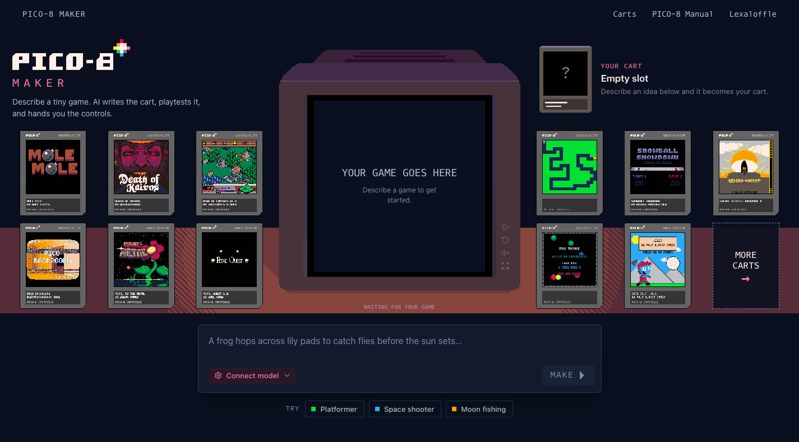

# PICO-8 Maker

**用对话，把一个想法做成可玩的 PICO-8 游戏。**

描述游戏想法，让 Agent 编写代码并在真实 WebAssembly 运行时里试玩，再通过对话持续修改。完成后导出 `.p8` 卡带。

[**在线体验**](https://boxuechen.github.io/pico8-maker/) · [English](README.md) · [参与贡献](CONTRIBUTING.md) · [开发指南](docs/development.md)



*当前开发预览。界面中的社区游戏和品牌素材有独立的署名与许可，见[第三方声明](THIRD_PARTY_NOTICES.md)。*

## 能做什么

- **对话创作**：描述玩法、提出修改，查看工具调用和真实游戏关键帧。
- **边做边验证**：Agent 在独立测试会话里运行游戏、输入按键、读取有界状态和日志。
- **查看完整卡带**：在工作台查看 Lua 源码，以及只读的精灵、地图、音效和音乐资源。
- **保留可玩版本**：区分草稿与已提交状态，支持撤销、前后对比和恢复已有对话。
- **导出作品**：把最近提交的版本保存为 `.p8` 卡带。

应用使用 React、assistant-ui、Pi Durable Agent 和 [pico8-web-player](https://github.com/boxuechen/pico8-web-player)。这是独立项目，并非 Lexaloffle 官方产品。

## 在线体验

使用 Chrome/Chromium 打开 [PICO-8 Maker](https://boxuechen.github.io/pico8-maker/)。试玩社区卡带不需要模型 Key；创作游戏需要配置自己的模型服务和 API Key。卡带与配置保存在当前浏览器，请求直接发送到你选择的模型服务。

## 快速开始

准备 **Node.js 24**、npm 和 Chrome/Chromium。首次启动需要联网下载固定版本的播放器，不需要播放器源码或 Emscripten。

```sh
git clone https://github.com/boxuechen/pico8-maker.git
cd pico8-maker
npm --prefix app ci
npm --prefix app run dev -- --host 127.0.0.1 --port 5175
```

打开 [http://127.0.0.1:5175](http://127.0.0.1:5175)。

1. 在首页输入游戏想法并创建卡带。
2. 选择模型并填写自己的 API Key；自定义服务还需填写 Base URL 和模型 ID。
3. 点击 **Test connection** 检查工具调用和图像输入能力，再发送请求。
4. 试玩并继续提出修改，点击 **SAVE CART** 导出卡带；**STOP** 可停止当前请求。

模型服务必须允许来自当前浏览器来源的请求（CORS）。当前流程要求模型支持工具调用和图像输入，专门的纯文本模式尚未实现。模型调用使用你的服务账户，可能产生费用。普通回归测试使用模拟模型响应和实际 WASM，不需要付费 API Key。

## 数据与模型连接

卡带、版本和对话保存在浏览器 IndexedDB 中。模型设置与 API Key 默认存入 localStorage，可以关闭记忆或清除配置。要继续原有项目，请使用相同的主机名和端口；清理浏览器数据前先导出需要保留的卡带。

浏览器直接向选定的模型服务发送请求，对话上下文、游戏代码和包含截图的工具结果可能随请求发送。Maker 不需要应用后端或共享的服务端 API Key。

## 测试与构建

```sh
npm --prefix app test
npm --prefix app run build
npm --prefix app run test:sites
```

静态部署目录为 `app/dist/client/`，通过 HTTP(S) 访问。构建也保留 Sites 所需的输出。播放器会一起打包到自己的站点，游戏运行时不从 GitHub Pages 跨域加载模块。

本地模拟模型、构建目录和播放器升级方法见[开发指南](docs/development.md)；显式调用真实模型的评测入口见[评测指南](app/scripts/evaluation/README.md)。

## 项目结构与依赖

| 路径 | 用途 |
| --- | --- |
| `app/src/` | 工作台、Agent 集成、卡带工具和浏览器存储 |
| `app/tests/` | 回归测试，包括真实 WASM 执行 |
| `app/player.lock.json` | 固定播放器静态地址、源码版本和 manifest 校验值 |
| `docs/pico8-agent/` | 版本化模型规则、按需参考和可运行示例 |
| `app/scripts/evaluation/` | 可复现模型评测与独立游戏检查 |

公开维护的项目为 **Maker** 和 [**Web Player**](https://github.com/boxuechen/pico8-web-player)。Maker 使用固定版本的 Web Player 静态构建；Web Player 自带 TypeScript 运行时及 C/C++ WASM 源码，不需要单独的运行时仓库。卡带兼容问题在 Web Player 修复，创作体验和 Agent 工作流在 Maker 维护。

## 当前状态与贡献

项目处于早期开发预览阶段，已验证浏览器为 Chrome/Chromium，不承诺兼容所有 PICO-8 卡带。现有案例和有界评测只说明已验证的具体行为，不代表任意模型都能稳定生成高质量游戏。

验证证据、已知限制和后续工作见[开发状态](docs/development-status.md)。欢迎中英文 Issue 与 Pull Request，提交前请阅读[贡献指南](CONTRIBUTING.md)。

## 许可证与致谢

项目自有代码和文档采用 [MIT 许可证](LICENSE)，版权归属 © 2026 boxuechen。第三方软件、社区卡带、字体和品牌图片保留各自条款，**不会因为项目使用 MIT 而被重新授权**。该许可证也不改变用户创建或导入卡带的权利。

感谢 Pi、assistant-ui、React、播放器及其上游组件、Proggy Vector 和社区游戏的作者。来源与许可记录见[第三方声明](THIRD_PARTY_NOTICES.md)。

社区卡带按项目维护者的决定保留，继续记录作者、来源与原始许可标注。发布计划和素材决策见[开源准备记录](docs/open-source-preparation.md)。
