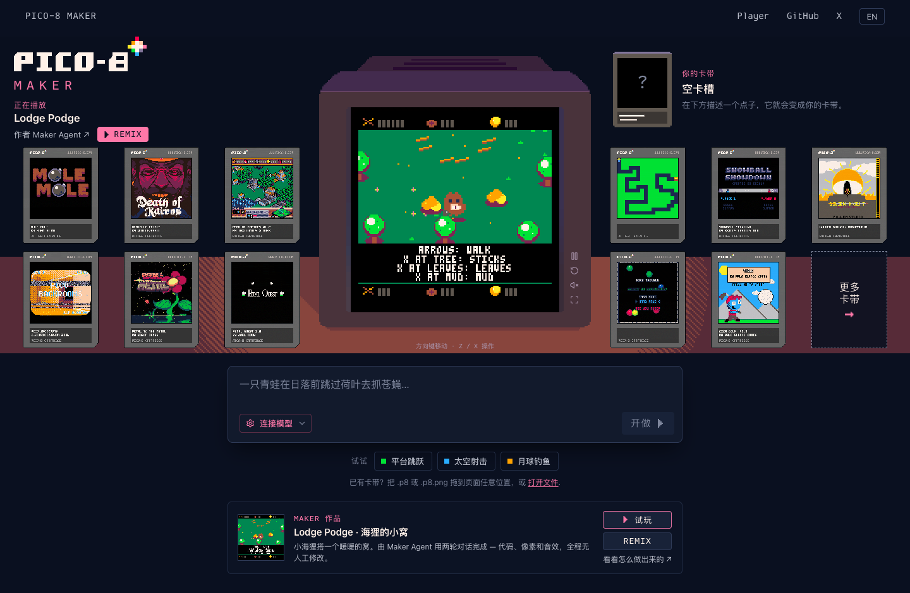

# PICO-8 Maker

**用对话，把一个想法做成可玩的 PICO-8 游戏。**

描述想法，让 Agent 编写代码并在 WebAssembly 中试玩，再持续修改并导出 `.p8` 卡带。基于 React、assistant-ui、Pi Durable Agent 和 [PICO-8 Player](https://github.com/boxuechen/pico8-player)。

[](https://github.com/boxuechen/pico8-maker/actions/workflows/ci.yml)
[](LICENSE)

[在线体验](https://boxuechen.github.io/pico8-maker/) · [English](README.md) · [参与贡献](CONTRIBUTING.md)



## 使用 Maker

- 对话创作与修改游戏，查看工具调用和可玩预览。
- 让 Agent 在独立会话中输入按键、查询状态、检查游戏画面。
- 查看代码与资源，撤销修改、对比版本、恢复已有对话。
- 将最近提交的游戏导出为 `.p8` 卡带。
- Remix 社区卡带或由 Agent 制作的 **Lodge Podge** 示例，也可以拖入自己的 `.p8` / `.p8.png` 试玩并继续改造。
- 在浏览器中管理“我的卡带”：重命名、复制、可撤销的删除，以及一键保存所有未保存的卡带。
- 界面支持 English / 简体中文切换。

使用 **Chrome/Chromium** 打开在线演示。试玩社区卡带和 Lodge Podge 示例无需模型 Key；创作前配置自己的模型地址和 API Key，再点击 **测试连接**（英文界面为 **Test connection**）。服务需支持工具调用、图像输入，并允许当前浏览器来源的请求（CORS）；模型调用可能产生费用。**停止**（STOP）中断请求，**保存卡带**（SAVE CART）导出卡带。

## 快速开始

使用 **Node.js 24.22.2** 和 npm。首次启动会下载固定版本的 Player，无需播放器源码或 Emscripten。

```sh
git clone https://github.com/boxuechen/pico8-maker.git
cd pico8-maker
npm --prefix app ci
npm --prefix app run dev -- --host 127.0.0.1 --port 5175
```

打开 [localhost:5175](http://127.0.0.1:5175)。测试、部署和 Player 升级方式见[开发指南](docs/development.md)。

## 数据与模型访问

卡带、版本和对话保存在浏览器 IndexedDB。模型设置与 API Key 默认存入 localStorage，可关闭记忆或清除配置。保持相同来源地址才能继续访问这些数据；清理浏览器数据前，请先导出重要卡带。

请求从浏览器直接发往选定的模型服务，可能包含对话、游戏代码及截图等工具结果。Maker 无需应用后端或共享服务端 Key。普通回归测试使用模拟响应，无需付费模型账号。

## 文档

| 主题 | 指南 |
| --- | --- |
| 环境、测试、部署和 Player 升级 | [开发指南](docs/development.md) |
| 当前能力、评测证据和后续工作 | [开发状态](docs/development-status.md) |
| Agent 设计（shell、`p8`、pico8 skill）与路线图 | [Shell 路线图](docs/shell-roadmap.md) |
| 可复现的模型评测 | [评测指南](app/scripts/evaluation/README.md) |

项目处于早期开发预览阶段，浏览器验证范围为 Chrome/Chromium；卡带兼容和模型生成质量均有局限。Maker 负责创作与 Agent 工作流，Player 负责卡带执行。

## 许可证

原创代码与文档采用 [MIT](LICENSE)。社区卡带、字体和品牌素材（包括截图中的内容）保留各自授权，详见[第三方声明](THIRD_PARTY_NOTICES.md)。这是独立项目，并非 Lexaloffle 官方产品。
