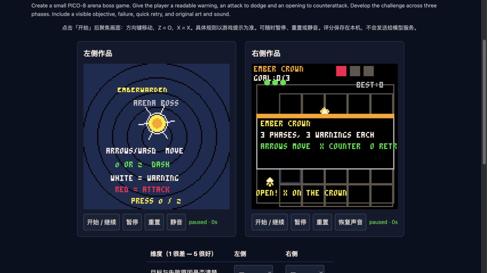

# DeepSeek Flash: first paired game-generation pilot

**The added knowledge pack did not demonstrate an overall improvement in this pilot.** It produced a working three-phase boss encounter where the baseline crashed, but also two compilation failures, a rescue game with a stationary win exploit, an exploration game whose starting player is offscreen, and a garden whose default weather prevents harvesting. The baseline also has substantial defects. This is evidence about reliability and mechanics in these twelve outputs, not a human preference result or a general verdict on knowledge packs.

Status: twelve real-provider generations and an independent agent audit completed on 2026-11-12. **Human reviewers: 0.** No enjoyment scores or pairwise human preferences have been collected. Outputs were frozen before review and were not repaired. The blind review page is ready, but the planned human study remains outstanding.

## Comparison and budgets

| | A: previous knowledge | B: expanded knowledge |
| --- | --- | --- |
| Knowledge revision | `4460b30` | `b1156e2` |
| Reference count | 27 | 44 |
| Attempts | 6 | 6 |
| Retained authored cart loads and survives 120 idle frames | 6/6 | 4/6 |
| Provider-reported cumulative tokens | 1,269,835 | 1,317,818 |
| Reference-reading calls | 50 | 69 |
| Button-playtest calls during generation | 16 | 4 |
| All tool calls | 99 | 108 |
| Mean generation duration | 82.47 s | 83.80 s |
| Catalog-estimated cost, USD | $0.15158 | $0.15974 |

Total: **2,587,653 cumulative tokens**, approximately **$0.31132** using the Pi catalog rates recorded for this run. This is not a provider billing receipt. The input totals include cached history; they are not unique context tokens. Costs include the final budget-aborted response, which may be absent from the conversation-level usage file. [Machine-readable metrics](metrics.csv) and [detailed summary](summary.json) retain each attempt and error.

The provider's authenticated model catalog identified `deepseek-flash` as **DeepSeek-V4.1-Flash**. See [the model-list receipt](model-list.json). Both conditions used this alias, thinking off, provider-default temperature, no seed, no retries, no conversation compaction, and fresh Pi Durable conversations. An alias is not an immutable weight snapshot; provider metadata and system fingerprints remain in the local traces.

The user-approved limits were 200,000 cumulative tokens, 12 minutes and 80 tool calls per game, with one repetition per condition rather than the protocol's proposed three. All twelve stopped on the token budget. **Actual usage was 201,776–229,484 tokens per attempt (0.89–14.74% over the target).** The runner stops when streaming usage arrives, but cannot reclaim input tokens already accepted by the provider. This is a protocol deviation, not a strict 200,000-token experiment. The time and tool ceilings were not reached. No unfinished attempt was dropped or selectively rerun.

A and B used the same six extension tools, PNG/ASCII observation, empty starting Lua, actual app Game tool implementation, and real WASM player. `read_reference` had the same string-ID schema in both arms; only each condition's index and reference content differed. A could not read B-only documents. The 27 baseline references were hash-checked as unchanged in B. [plan.json](plan.json) records settings, source fingerprints, randomized run order and pack hashes; [pack-A.json](pack-A.json) and [pack-B.json](pack-B.json) archive the actual model-facing material.

The application was imported once into the generation process, so concurrent repository edits did not change later games' loaded modules. The runtime, observation and extension fingerprints still matched at review. The workspace was not a fully isolated checkout: parallel storage/export changes altered `app/src/game.js` after the recorded fingerprint, and that exact intermediate file was not archived. The knowledge packs are fully frozen; full application reconstruction from the commit alone is therefore not guaranteed. A follow-up should snapshot the entire harness and lockfile before starting.

## What actually happened in each pair

These are objective checks and source-supported findings by the reviewing agent. They are **not** blind human scores.

| Fixed task | A: previous knowledge | B: expanded knowledge |
| --- | --- | --- |
| Parcel platformer | `09a1cafe`: loads, but `state` is never initialized to play. All six controls and moving/jump combinations leave the player at `(16,112)`. | `0df805f9`: all four load attempts fail; no authored cart retained. |
| Rooftop repairs | `81a86279`: controls, death and respawn work. Highest measured jump feet position is `y=98.4997`; the lowest raised platform is at `y=88`. There is no other ascent mechanism, so the antenna objective is inaccessible. | `2e21b2d5`: all four load attempts fail; no authored cart retained. |
| Three-phase boss | `bdedfb71`: title loads; starting faults at line 407 because `math` is nil. | `5225069a`: actual movement, dodging and counters reach all three phases and win with six hits and full health. A poor stationary policy dies; X resets HP, hits and phase. HUD says `goal:…/3`, which does not match the six-hit total. |
| Timed rescue | `5feacc7d`: real pickups and crossings complete level 1 and enter level 2. A bounded 18,000-frame policy exercises washouts but does not finish all three levels. This does not prove no winning policy exists. | `5c0fa848`: six O presses at the initial `(34,64)` produce victory with no crossing. Stranded count stays four: pickup uses `del(stranded,1)` on an array of tables, and immediate unloading at the spawn bank increments the score. |
| Resource extraction | `a4a61997`: actions, damage, defeat and retry work. A shortest spatial route with waits dies on turn 11; another winning route has not been established. | `497113b1`: an input route retrieves the key and returns in 12 turns; fuel depletion and retry also work. However, the player starts at pixel `y=132` and the key is on the same offscreen row. The 7×9 map with 16-pixel cells does not fit 128×128; HUD also overlaps the map. Winning by internal coordinates is not evidence of readable human play. |
| Garden season | `85f23650`: starting faults because drawing requests a fourth bed while only three exist. Source inspection also finds an unbound planting function. | `d45dc10f`: the season ends and retry works, but default sunny weather removes every dose immediately after watering, preventing harvest. Six waits score 9; sowing plus five watering actions scores 6 with zero blooms. It does not establish the requested two viable growing strategies. |

The boss is a clear functional improvement in this pair. The garden gains a functioning season loop but still fails its central objective. Neither result justifies counting B as “more fun overall.” The exploration win is also not a clean success: the review policy used hidden coordinates that a human cannot see.

All ten retained carts are available in [games/](games/); failed attempts contain result metadata rather than a misleading empty starter cart. The group labels are visible in this report, so **read this report after a blind trial** if unbiased human preference is the goal.

## Evidence and limits of the audit

There are thirteen recorded checks covering the ten retained carts, with source hashes, exact buttons/frame counts, observed state and diagnostics under [evidence/](evidence/). Selected state was copied to unused scratch RAM after drawing, without changing game variables. Each instrumented input trace was then replayed through the public player using the **unmodified** final Lua. Successful checks ended with pixel-identical frames; the garden fault reproduced the same original error, and the baseline boss was checked directly without instrumentation. This supports reproducibility, not an exhaustive proof of all play paths.

Examples:

- [Boss win](evidence/5225069a-win.json) and [defeat/retry](evidence/5225069a-loss-retry.json).
- [Stationary rescue exploit](evidence/5c0fa848-stationary-win.json).
- [Offscreen extraction start and successful route](evidence/497113b1-key-return.json), with [the starting frame](evidence/497113b1-start.png).
- [Garden waiting](evidence/d45dc10f-rest-retry.json) versus [planting/watering](evidence/d45dc10f-plant-water.json).
- [Baseline garden crash](evidence/85f23650-actions.json), [baseline boss crash](evidence/bdedfb71-start.json), and [bounded rescue play](evidence/5feacc7d-crossings.json).

Non-silent PCM was observed for the eight carts that could be exercised without the two immediate start crashes. This establishes audio output, **not** that music is pleasing or cues are well mixed. Pixel screenshots were inspected for visibility, but no numerical art-quality scores were assigned. Cross-session save persistence, optional-reward balance, all random boss patterns, all rescue levels and non-default garden scenarios were not fully tested. Main actions and terminal states are not uniformly successful; the 6/6 versus 4/6 idle count must not be called a playable-completion rate.

Complete real request contexts, wire payloads, responses, tool results, intermediate source versions and PNGs remain under `.cache/evaluations/deepseek-flash-20261112-round1/` (about 30 MB). [The artifact index](local-artifact-index.json) records their paths, sizes and hashes. It is an index, not an embedded copy of those raw files. Credentials and authorization headers were not stored in these artifacts.

## Likely causes and next experiment

The observed resource tradeoff is worth acting on: B made **69 reference calls versus 50**, but only **4 button-playtest calls versus 16**. Its extraction run read references 22 times before its first load and never pressed a button. B's two platformers spent their load attempts repairing syntax and never retained a working cart. Five of B's six tasks read `guide/playtest`; reading a test checklist plainly did not guarantee executing it. These are correlations from one run per task, not proof that reference volume alone caused the failures.

B did use the new material: the boss read `case/just-one-boss` and `recipe/signal-arena`; extraction read `case/porklike` and `recipe/lantern-vault`. The rescue and garden outputs changed the theme and rules rather than copying a dungeon unchanged. Nevertheless, mechanics transferred poorly and feature/asset generation outpaced basic validation. More examples by themselves are not the best next intervention suggested by these traces.

Recommended next iteration, **not implemented as part of this experiment**:

1. Make the initial routing narrower: one relevant pattern and at most one small example before the first playable load; avoid reading the whole library.
2. Require evidence for a playable objective before expanding art/audio: start, one main action, actual success, intentional failure, reset. Reserve a declared portion of the budget for these checks.
3. Add compact author checks for jump reach, map bounds, resource invariants and “do nothing / spam one button” exploits. These are generation requirements, not permission to patch outputs during evaluation.
4. Enforce request admission using a conservative remaining-token estimate, and archive the complete harness before starting. Continue reporting provider usage and overshoot explicitly.
5. Repeat with multiple seeds/runs, gather at least three independent human reviews, and use new held-out tasks after tuning. Do not present retesting these same six prompts as unseen validation.

## Human review

The running local page at **http://127.0.0.1:5193/** presents randomized left/right carts without condition labels or reference logs. Each game has start, pause, reset and mute controls, a played-time indicator, six dimensions with an explicit “unable to rate” option, and pairwise left/right/tie/unable preference. Scores are stored locally under the run directory. No fabricated test ratings were submitted.

The UI was checked with real Worker/WASM loading, title-to-game input, pause, reset/mute feedback, task switching and visible fault reporting. This UI check is not a human enjoyment review. The user can invite reviewers who have not read the unblinded report; treatment mappings must remain private until their ratings are collected.



## Reproduction

From the repository root (dependencies and player build already present):

```sh
node --test app/tests/evaluation.test.mjs
node app/scripts/evaluation/run.mjs --prepare-only --out .cache/evaluations/a-new-unique-run
# A real generation run needs DEEPSEEK_API_KEY in the process environment,
# or --key-stdin from a non-echoing credential source. Never put it in argv/files.
node app/scripts/evaluation/run.mjs --out .cache/evaluations/a-new-real-run
node app/scripts/evaluation/assess.mjs .cache/evaluations/deepseek-flash-20261112-round1
node app/scripts/evaluation/summarize.mjs .cache/evaluations/deepseek-flash-20261112-round1
node app/scripts/evaluation/serve.mjs .cache/evaluations/deepseek-flash-20261112-round1
```

`assess.mjs` is a case-specific audit of this frozen batch, not a generic automated fun benchmark. `REVIEW_ID=<opaque ID>` reruns one cart's checks without model requests. Starting a new real run incurs new provider usage; the commands above were not used to generate extra selective retries. The three harness tests pass: reference isolation, real runtime/rollback/non-advancing observation, and PNG/budget accounting.
