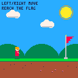
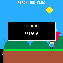
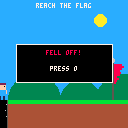
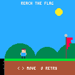

# PICO-8 Agent 契约修复与 skills 实测 · 2026-11-13

四项修复已完成。保留单 Agent、薄 extension、九个工具、按需加载 skills 和模型自行结束任务；本轮没有引入生产工具轮数上限、finish 工具或自动续跑 hook。

## 实现

| 问题 | 修复 | 证据 |
| --- | --- | --- |
| read_game 承诺完整源码，但 Harness 会截断 | 明确首段读取；复用 Pi 内置行分页，返回可直接调用的 read 续读参数；超长单行使用仅限源码的 UTF-8 字节范围 | 真实 Agent → Harness → 模拟 provider 验证行数、字节数、UTF-8 超长行三种边界；后续请求均读到尾部，不启动游戏 |
| 自身编辑被当作其他会话的变更 | 每次 send 固定进入请求时的项目基线；当前工具结果更新状态；下次请求重新判断外部变更 | 同轮 edit/load 后无误报，后续外部修改仍触发提醒 |
| 代码预算、草稿和观察版本对模型不可见 | read_game 和运行观察返回 committedRevision、draftDirty、draftSourceBudget；cart.observed 标明已提交版本或失败草稿 | 真实 WASM 覆盖超预算仍能加载、资源草稿、失败回滚、已提交帧归属 |
| 缺少真实模型 skills 行为评测 | 新增开发评测页和归档，覆盖创建、局部修改、资源修改、只试玩、只解释、压缩恢复；根据首轮失败加强 AGENT 路由 | 两轮完整批次，共 24 次真实模型任务，结果如下 |

预算为提示信息。token 计数是近似值，源码长度分别报告 JavaScript 字符长度与 UTF-8 字节数；没有新增源码限制，也没有验证官方 PICO-8 压缩尺寸或编辑器兼容性。`cart.observed.cartRevision` 与运行时的 sessionId/generation/revision/frameId 分开保留。

## 模型与方法

使用用户指定的网页已保存配置：`deepseek / deepseek-flash / thinking high`。凭证在浏览器内使用，没有读取到终端、报告或源文件；没有调用 Anthropic 服务。模型别名可能随服务更新，本结果只对应这次运行。

每轮六个固定任务各执行两次，使用生产 Agent/Game、真实 Pi Durable 1.5.2 和真实 Worker/WASM。任务、初始完整卡带与评分代码见 `app/scripts/evaluation/skills-cases.mjs`。每次创建独立临时 cart，不写入用户卡带架或对话。评测专用预算为每次 180 秒、40 次工具调用；两轮均自然结束，未触发预算停止。

压缩任务先写入明确标注的合成长历史，由真实模型生成 Pi compaction，再序列化并重建 Agent；不是伪装成长时间真实游戏开发的历史。随后执行相同的速度修改。首轮输出冻结后才加强路由，复测运行同样的全部 12 项，没有挑选成功重试或修改生成的游戏。最终路由明确要求小改动也先读对应 skill、测试前读 playtest，并在压缩后正文不在上下文时重读。

## 两轮结果

下表为自动检查通过次数。它同时检查完成、相应 skill 的成功读取和任务范围约束；创建任务的自动通过不代表全部玩法或质量通过。

| 任务 | 原路由 | 加强路由后 | 首轮未通过原因 |
| --- | --- | --- | --- |
| 创建游戏 | 1/2 | 2/2 | 一次未读取 playtest skill |
| 修改移动速度 | 2/2 | 2/2 | — |
| 仅修改 sprite 1 | 0/2 | 2/2 | 两次未读取 assets skill |
| 只试玩 | 2/2 | 2/2 | — |
| 只解释 | 2/2 | 2/2 | — |
| 压缩后继续修改 | 0/2 | 2/2 | 两次未读取本任务所需全部 skills |
| 合计 | 7/12 | 12/12 | — |

排除无需技能的解释任务，所需技能读取通过率为 **5/10 → 10/10**。两轮各 12 项全部自然完成；首轮所有其他预设自动检查通过。第二轮 130 次工具调用，无工具错误；第一轮 128 次调用，包含 2 次模型后续自行恢复的工具错误。各项工具次数、耗时、首次成功提交时间、失败检查和完整卡带散列见 [summary.json](summary.json)。这些耗时包含网络与 provider 波动，不用于宣称速度提升。

修改和压缩任务的独立验证在捕获 Agent 工具记录之后执行：重置并向右移动 10 帧，以真实 RGBA 像素确认角色从 x=8 到 x=28；它不计入模型的试玩次数。资源任务要求 Lua、flags 和所有非目标资源逐字节不变；解释任务禁止运行、重置、按键、加载和修改。未把模型自述“测试过”当作工具证据。

## 最终生成游戏的独立重放

第二轮两次创建任务的最终完整卡带均未经修改，以真实 WASM 重新加载。创建 1：中性 1 帧 → 右 80 → 释放 1 → O 1 → 左 30 → 释放 1 → O 1。创建 2：同一序列，向右改为 60 帧。两者均观察到开场、胜利、失败及两种结局后的重试；各步运行诊断为空。证据包含源码/资源散列、每步输入、frameId 和 RGBA 散列：[创建 1](create-1.json)、[创建 2](create-2.json)。

| 最终卡带 | 获胜 | 失败 | 失败后 O 重试 |
| --- | --- | --- | --- |
| 创建 1 |  |  |  |
| 创建 2 |  |  |  |

这是简单固定任务的小样本开发评测。复测仍使用调优时见过的任务，不是留出集或随机对照实验；成功读取 skill 也不等于遵守其每条规则。未进行跨模型验证、人工趣味性评分、音频听测或官方 PICO-8 编辑器验证。创建 2 的 O 提示在游玩中也显示，但实现仅在胜负后重试；这不影响本任务要求的结局重试，也不能据此宣称文案或体验完美。

## 归档与回归

原始报告和执行快照保存在本地忽略目录；`summary.json` 记录原始报告 SHA-256、模型配置、知识版本和输出散列。报告包含完整协议记录、初始/最终/工作稿卡带、压缩记录和独立检查；执行目录包含 app/src、评测脚本、编译文档和 package-lock。旧批次没有覆盖。

- 原路由：`.cache/evaluations/skills-52a6dd75-bfe1-4346-b0cd-8f35c24cb979/report.json`，知识版本 `pico8-files-v1-55efb7a7f8c82d7c`。
- 最终路由：`.cache/evaluations/skills-348fdcf0-2c83-4713-b895-e3464366f104/report.json`，知识版本 `pico8-files-v1-bb07825a6820645a`。
- `cd app && npm test`：84/84 通过。
- `cd app && npm run test:sites`：4/4 通过，包含构建产物检查。
- `cd app && node --test tests/evaluation.test.mjs`：旧评测框架回归 3/3 通过。
- `cd app && npm run build`：通过，生成 Sites 所需 client/server/hosting 文件；Vite 仍提示现有大型 bundle。

重跑入口为开发服务的 `/evaluation.html`，操作和归档约定见 [评测说明](../../../../../app/scripts/evaluation/README.md)。重跑会产生新的 provider 请求与费用，不能覆盖本报告作为同一次实验。
