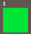
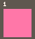

# 工具能力增强与回归 · 2026-11-13

上一轮修复已提交为 `1a39ed0`。本轮增强现有工具的执行反馈、序列试玩和资源预览，仍为九个工具。交互 Agent 保持自然完成、手动 STOP 和顺序执行。

## 工具契约

`press_buttons` 保留原来的 `{frames,buttons}`，也接受 `steps:[{frames,buttons},…]`。单次最多 8 段，总计最多 600 个逻辑帧，所有参数在执行前完整校验。段间不插入隐式释放帧；需要再次按下时显式传 `buttons:0`。

默认返回每段结束的 PNG。`captureFrames` 可指定最多 7 个相对本次调用起点的采样位置，最终帧始终包括在内；`[]` 表示只返回最终帧。结果包含总请求帧数、实际完成帧数、结束原因和实际执行到的步骤，每张图有独立的运行时身份及 `{step,afterFrames}`。中途停止、异常、会话替换或中断不会执行后续步骤。工作台时间轴保留这批关键帧，预览和封面使用最终帧。

加载、重置也返回启动步进进度。观察结果增加 `cpuInstructions` 和 `slowFrame`，仅代表该完成帧在本地 WASM 中的统计，不能当作整段性能分析或官方 PICO-8 CPU 百分比。异常发生时可能只能返回此前最后一张完成帧。

`read_assets` 增加 `version:"draft"|"committed"` 与 `format:"data"|"png"|"both"`。默认仍读草稿数据。精灵 PNG 是带编号的图集，文字结果含 flags 和对应图像区域；地图 PNG 带网格与地图坐标范围。预览采用原始基础调色板，颜色 0 显示黑色、地图 tile 0 留空，不应用运行时调色板、透明度、相机或 flags 过滤。资源预览不会启动 Worker、暂停播放器、推进帧或提交版本。

Resources 界面与工具复用像素渲染函数。`edit_assets` 返回批次最终实际改变的槽位、字段、地图区域和 dirty 状态；净结果未变时返回空 changes。重叠地图区域的 changedCells 可能包含同一个格子，不可相加作为去重总数。

## 自动验证

新回归经过真实 WASM 或真实 Harness 请求链路，覆盖：

- 无效序列在暂停播放器或创建 Worker 前拒绝；单次总帧数和截图数量有界。
- 多段移动的精确像素、每个采样点、实际帧数、观察不推进时间。
- 将持续按键分段采样后，与逐帧运行结果一致，`btnp` 时序不受影响。
- 真实 `stop()` 和 Lua 异常返回部分进度，并跳过剩余步骤；取消后没有后续输入。
- 草稿和已提交资源的颜色、flags、版本归属，读取预览不操作游戏。
- 地图渲染逐像素匹配 WASM，包括 tile 0、sprite 255 和地图右下边界。
- 八张关键帧完整到达模型请求，资源图像与版本信息也到达模型。

确定性夹具的原始工具 PNG 与元数据另保存在 `.cache/evaluations/tool-capabilities-fixture/`。它们是工具验证夹具，不冒充模型生成的游戏。

## 真实模型回归

复用网页保存的 `deepseek / deepseek-flash / thinking high` 配置。使用与上一轮相同的六个任务，每项两次，运行生产 Agent、工具、真实 Worker/WASM；临时 cart 不写入用户卡带架。没有调用 Anthropic 服务，没有从浏览器提取或归档凭证。

原始记录：`.cache/evaluations/skills-750eb327-8f9f-4320-8ef5-1e22ca3e903a/report.json`。知识版本为 `pico8-files-v1-502636dc0427b59b`。执行开始时的源码、评测脚本、编译文档和依赖锁文件保存在同目录 execution/。

12/12 预设自动检查通过，全部自然完成；模型总计调用工具 100 次，其中 28 次按键调用执行了 54 段输入，4 次资源 PNG 预览。细项、原始报告 SHA-256 与最终源码/资源散列见 [summary.json](summary.json)。

| 任务（各两次） | 自动检查 | 工具调用 | 按键调用 / 输入段数 | 资源 PNG 预览 |
| --- | --- | --- | --- | --- |
| 创建 | 2/2 | 18 | 4 / 16 | 0 |
| 局部修改 | 2/2 | 23 | 7 / 13 | 0 |
| 资源修改 | 2/2 | 17 | 0 / 0 | 4 |
| 只试玩 | 2/2 | 20 | 11 / 15 | 0 |
| 只解释 | 2/2 | 3 | 0 / 0 | 0 |
| 压缩后继续 | 2/2 | 19 | 6 / 10 | 0 |

保留了一次真实工具错误：create-2 最初用 `.` 表示精灵背景，被现有十六进制行校验拒绝，随后模型自行改为 `0` 并完成。没有部分资源写入，没有人工修改生成结果或选择性重跑。自动检查通过不意味着期间没有模型错误。

模型实际收到的原始工具 PNG 和对应 observation/resourceView 元数据保存在 [evidence/index.json](evidence/index.json)。查看两次创建任务的关键帧，可见胜利、失败、重试后的可操作画面；资源任务显示从绿色到粉色，范围检查确认 flags、源码和其他资源保持不变。

| 样本 | 获胜关键帧 | 失败关键帧 | 重试后的关键帧 |
| --- | --- | --- | --- |
| 创建 1 |  |  |  |
| 创建 2 |  |  |  |

资源 1 的工具预览：修改前 ，修改后 。这些是 authored-resource PNG，和游戏运行画面有明确区分。

上一轮相同任务批次为 130 次工具调用、51 次按键调用；本轮为 100 和 28。评测仍是单模型、固定任务的小样本；两轮生成内容、修正次数及模型决策不同，不能据此单独宣称因果性的效率或质量提升。没有跨模型验证、人工趣味性评分或官方 PICO-8 性能验证。

## 最终检查

- 应用回归：93/93 通过。
- 旧评测框架：3/3 通过。
- Sites：4/4 通过。
- 生产构建通过，client/server/hosting 产物齐全；仍有原有大型 bundle 提示。
- 浏览器确认主页正常加载，真实模型评测页显示 12 项完成及归档路径。
