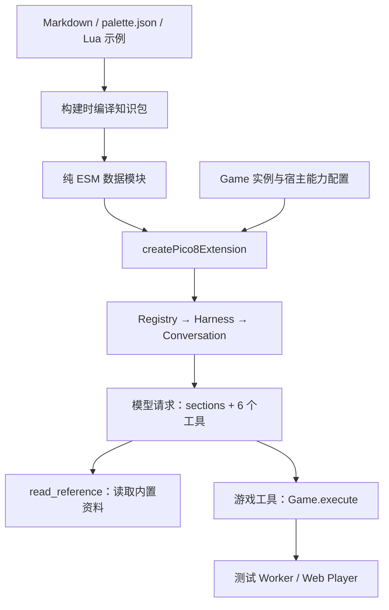

# Pi Durable 接入 PICO-8 extension

> 实施更新：英文知识包、常驻 sections、read_reference 与历史恢复验证已接入。原设计中的“未实现”描述为设计时状态；当前入口见 app/src/pico8/extension.js。ASCII 仍未接入。


日期：2026-11-12。依据：项目安装的 `@earendil-works/pi-durable@1.5.2`。状态：接入设计，未修改应用代码，未执行新的集成测试。

本方案承接 [知识设计](pico8-agent-design.md) 与 [创作知识包](pico8-agent/README.md)，明确第一版怎样装配。这里的模块、函数和资料工具是拟议接口，不表示已经存在。

## 1. 推荐方案

扩展当前已有的 `pico8` extension：**常驻知识 sections + 原有五个游戏工具 + 一个 read_reference 工具**。保持单 Agent、单项目和现有游戏运行链路。

Pi Durable 已经承担模型循环、schema 校验、工具调度、取消和 transcript。知识内容及其加载属于应用职责；无需引入 coding-agent 的文件系统、bash、通用 skills 扫描或 MCP 中转。



资料加载与游戏执行各走自己的函数。读音频文档不应调用 Game.execute，也不应创建/暂停测试 Worker。

## 2. 从现有实现怎么迁移

当前 `app/src/agent.js` 已在 `Agent.open()` 中注册 `defineExtension({ name: "pico8", tools })`，并将硬编码 `instructions` 传给 root。因此不需要引入第二套 agent runtime。

| 当前职责 | 建议位置 |
| --- | --- |
| 模型配置、Harness、send/abort/watch、历史恢复 | 继续放在 `Agent` |
| 工具描述/schema 与 defineTool | 移到 `createPico8Extension` 附近 |
| 常驻提示词 | 由知识包装配成 extension sections |
| Lua 执行、输入、截图、版本提交 | 继续由 `Game` 执行 |
| Markdown 与 recipe 读取 | 新增纯资料模块，不经过 Game |
| assistant-ui 消息投影 | 保留原投影，补充新工具显示名 |

保留工具名 `read_game/load_game/reset_game/press_buttons/observe_game`，使历史记录与 UI 的识别继续有效。只增加 `read_reference`。

旧提示词中的“只使用绘图函数”“初始跳墙关卡”“最多修改三次”不再作为通用创作规则。修改任务的具体限制来自用户请求与当前源码。编译成功不等于玩法通过、禁止编造证据等规则由 AGENT 文档承担。

## 3. 知识包加载：推荐构建时生成 ESM

维护一个显式 manifest，列出每个资料的稳定 ID、源文件、用途（section/reference/recipe）、标题、必要的小节边界与内容版本。文档正文仍只有 `docs/pico8-agent/` 这一份来源。

构建脚本读取 manifest 指定文件、校验、生成 `app/src/generated/pico8-knowledge.js`，导出普通 JS 数据。生成文件不手工编辑，不作为第二份知识来源；推荐忽略提交，由命令自动生成。

这比在 `agent.js` 中直接导入 Markdown `?raw` 更适合当前项目：现有 Node 测试直接 import Agent，Node 不认识 Vite 的 raw loader；纯 ESM 同时适用于 Node 和 Vite。也不必在浏览器运行时 fetch 文档或配置跨目录静态资源服务。

建议增加 `prepare:knowledge`，由 predev/prebuild/pretest 调用。保留原有 prepare-player 与 Sites 构建链。直接执行 `node --test` 前需先准备知识包；`npm test` 自动准备。缺文件或不合法内容应在准备阶段失败，不能带空知识悄悄启动。

该方案细化并替代前一版设计中“Vite 与 Node 分别读取 Markdown”的备选装载方式：两种环境都使用同一个生成模块，装配和校验逻辑只维护一份。

拟议的运行模块：

```text
docs/pico8-agent/manifest.json          # 稳定 ID 与来源/分块定义
app/scripts/prepare-knowledge.mjs      # 读取与编译，使用 Node 内置 API
app/src/generated/pico8-knowledge.js   # 生成的内容数据
app/src/pico8/extension.js             # sections + 工具注册
app/src/pico8/reference.js             # 按 ID 读取，纯函数
app/src/pico8/capabilities.js          # 游戏工具与宿主说明共享的能力常量
app/src/agent.js                      # 会话生命周期和 UI 投影
```

第一版不需要嵌入向量、搜索服务或额外 backend。完整资料进入浏览器 bundle，但只有常驻部分和被调用的资料进入模型请求。

### 模型可见文本需要处理什么

- 排除开发者文档 README/SOURCES/VALIDATION/verify.mjs，不把部署、验证命令或本地文件路径发给游戏模型。
- AGENT 草稿的“尚未接入”提示属于文档维护状态，装配时移除。建议用明确的 metadata/标记边界，不用模糊正则删除所有引用块。
- HOST 从实际 capabilities 渲染，不原样复制“read_reference 尚未接入”等过渡描述。
- 资料间的本地 Markdown 链接映射为稳定 reference ID 和调用提示；未知链接在构建时被列出。外部官方链接可保留作来源，但不能暗示模型有浏览工具。
- Lua 示例按文件原文完整返回，不能把 helper、注释或关键资源初始化裁掉；recipe 的源码 hash 与验证报告匹配才标为“已验证”。
- palette 的文字表从 JSON 生成，避免另维护一份英文/中文映射。颜色表示与正式观察编码器以后共用数据。

## 4. 常驻 sections 与 instructions 的分工

| Section key | 内容 |
| --- | --- |
| `pico8_agent` | 创作/修改流程、证据标准、交付方式 |
| `pico8_machine` | 屏幕、Lua 数值、生命周期、输入、资源和存储基础 |
| `pico8_palette` | 默认 16 色编号、字符、中文名与 RGB；扩展色按需参考 |
| `pico8_references` | 从 manifest 生成的 ID、标题、何时读取；无需全文 API 清单 |
| `pico8_host` | 当前提交/观察格式、输入帧数、测试存储模式、音频回传等实际能力 |
| `pico8_knowledge` | 知识包 schema/version/hash，供恢复与调试追溯 |

`agent.instructions` 在 Pi 中渲染于 extension sections 之后。首版可不设置；若以后需要会话专用规则，只放该会话的小段补充，不再重复整个 AGENT 文档。

核心领域规则全部由同一个 extension 提供。Section render 只返回已校验文本，不在每次模型请求中读文件、fetch URL、启动 Worker 或采样游戏状态。

源码、当前帧、实际显示色表、诊断属于工具结果，不是系统指令。稳定 section 有利于缓存；`section` 本身不会自动压缩长文档或让它们免占上下文。

当前五份原始常驻候选文档合计约 18,095 UTF-8 字节（9574 字符），这是源文档大小而非最终 token 数。去除开发说明、按 JSON 生成 16 色表、生成简明目录后再测实际模型请求。不要直接声称已达到此前 2–4K token 的目标。

能力说明与执行代码共享一个定义，例如观察格式 `["png"]`、maxInputFrames=120、测试 persistence=`memory`、audioObservation=false。不会因为知识包写了 ASCII 设计就提前向模型宣告支持。

## 5. read_reference：首版采用稳定 ID

建议首版参数为 `read_reference({ id })`，id 在 schema 中列出允许值。领域固定、资料量小，稳定 ID 已够用。暂不设计自由路径、任意 URL、模糊符号检索与通用分页。

示例 ID：

```text
guide/lua
guide/graphics
guide/sprites-maps
guide/audio
guide/memory-storage
guide/input-system
guide/playtest
palette/full
recipe/sprite-from-rows
recipe/map-from-rows
recipe/sfx-from-notes
recipe/music-from-patterns
recipe/save-high-score
api/audio
api/memory
... 其余 inventory 类别
```

这比此前的 `{topic,symbol}` 更适合首版：当前资料是章节和完整文件，尚没有可靠的逐符号结构化索引。可以先完整读一个 2–6 KB 专题或完整 recipe；未来有实际查找需求再加符号索引，不以字符串 contains 猜函数文档边界。

`api-catalog.md` 当前约 24,965 字节，按类别编译成多个 `api/<category>`，不每次返回整个 113 项目录。类别边界使用 manifest 中明确的标题定位并校验唯一性。

返回给模型的 `output` 包含：ID、标题、packVersion、内容 hash、正文、必要的关联资料 ID。必须放在 `output`，不能只放 `details` 或 `structuredOutput`。

建议 `details` 放简短的 ID/title/hash/bytes，方便 UI 后续展示；首版保持现有文本工具结果也能工作。当前 projectView 只投影 output 中的文字，不会自动显示 details，需要时再增加映射。

### 有界输出

建议资料结果完整序列化后不超过 16 KiB / 256 行，并设置相同的 Pi `outputLimits`（retain=`head`）。编译阶段计算包含 metadata 的最终输出尺寸；超限就拆成明确子项，并在目录中展示，不依赖 Pi 静默截断代码。

当前普通专题最大约 5.1 KB，完整 recipe 更小，具备一次返回的空间。不能用字数代替 UTF-8 字节数，中文尤其如此。长 API 类别也必须通过相同检查。

未知 ID 按 schema/执行检查返回错误及可用 ID，错误不能落入 Game.execute。内容以固定知识包对象读取，`replay: "safe"` 合适；它没有游戏状态副作用。safe 表示重试不会重复产生外部影响，不意味着未来换了内容版本仍返回相同正文。

## 6. Extension / Harness 的装配

以下为接口示意，不是本轮实现：

```js
const pico8 = createPico8Extension({ game, knowledge, capabilities });
const registry = createRegistry();
registry.install(pico8);

const harness = await Harness.open(
  new MemoryStorage(),
  {
    models,
    registry,
    settings: () => ({
      retry: { maxRetries: 0 },
      compaction: { enabled: false },
      toolExecution: "sequential",
    }),
  },
  context,
);
const root = await harness.root(context, {
  agent: { extensions: [pico8], maxTurns: 24, thinkingLevel: "off" },
});
```

显式选择 extension 便于未来 registry 加入其他扩展后仍保持此会话的范围。不额外复制一份 tools 名单到 root；否则新增资料工具容易漏更新。

保持现有模型 provider/configure、watch、取消与历史导入流程。App 将知识包注入 Agent，Agent 将 Game 与知识依赖交给 extension；Node 测试可注入同一生成包或小 fixture。extension 模块不能依赖 DOM、React 或 Vite 专用语法。

五个游戏工具首版保留 `replay: "unsafe"` 与 sequential；不要顺手把 observe_game 改 safe，因为当前路径可能懒创建测试 Worker、加载源码并暂停试玩。maxTurns=24 限制模型工具循环轮数，不是独立工具调用总数；资料读取也会占用循环，不为接入知识包立即无限增大预算。

此阶段不加 hooks 自动修改/测试，也不接 Code Mode、tool_search、subagent。关键校验继续在 schema 和 Game 实现中完成；描述文件不能代替帧数、源码长度、超时或候选代码提交检查。

## 7. 历史恢复与版本

现有 `compactTranscript()` 保存各 entry 的 model 消息，包含 Pi 产生的 system sections/tool declaration 变化；不只是用户与助手文字。恢复时还可能看到旧的硬编码 instructions。

Pi 1.5.2 的 `planSystemEntries()` 会比较已重放 sections/tools 与当前 desired，补充变化并以 null 移除过时 section。应利用这个机制，在下一次真实模型请求时检查旧规则已撤销；不要凭 root 创建成功或 UI 显示新文档就认为迁移完成。

当前 MemoryStorage 每次打开重新创建 root，移除旧 instructions 设置即可由下一次请求协调系统上下文。未来如果直接重开持久化的旧 root，首次创建参数不能代替迁移，应显式 configure 清除旧 instructions、选择新 extension。

首次接入保留资料工具的完整文本历史，与现有持久化策略一致，不新增隐式去重/摘要。每个结果包含版本，旧资料是历史证据，不冒充当前版本；知识版本变化时当前 section 提醒重新读取相关参考。重复读取会增大上下文，这个限制需要计量，但不在第一版同时引入 compaction 迁移。

只读资料的重读不触发游戏操作。未完成工具调用继续用现有 interrupted 结果修复，不恢复旧游戏按键。将来若采用 durable storage 自动恢复任务，需把知识版本固定到会话/调用或保留旧包，以避免工具重放跨版本漂移。

## 8. 最小实施批次

1. **资料装配**：manifest、编译脚本、生成模块、构建前置命令。验证内容、ID、链接映射、recipe hash 与尺寸。
2. **Extension 接入**：抽出五工具，增加六个 sections 和 read_reference，移除旧 root instructions，保留 Game 执行逻辑。
3. **恢复与 UI**：资料工具显示名；验证旧历史升级后的下一次请求；确认刷新恢复、STOP、provider 切换和试玩仍正常。
4. **模型验收**：先用 fixture 检查请求契约，再用真实模型执行含 sprite/music/save 的任务，确认模型确实读取资料并运行游戏。

ASCII 编码、观察裁剪、音频回传和 IndexedDB 存档另设后续批次。它们都不是知识 extension 生效的前提，也不能在这个批次中误报为已开放。

## 9. 验收标准

| 检查 | 必须看到的证据 |
| --- | --- |
| 实际模型上下文 | fixture 接收到新 sections、六个工具；旧跳墙/几何绘图限制不再生效 |
| 文档装配 | 浏览器和 Node 使用同一生成包；无绝对本机路径、草稿状态或不存在的能力 |
| 资料工具 | 明确 ID 取回对应原文；recipe 完整且 hash 相符；无 Worker/游戏状态副作用 |
| 有界输出 | 所有输出均低于配置上限，没有被 Pi 截断；API 分类覆盖完整 |
| 历史迁移 | 导入含旧 system 消息的记录后，用首次模型请求验证 section 移除/替换；没有自动重放旧工具 |
| 交互 | 六种工具活动正常显示，STOP 与错误可恢复，读取资料后仍能试玩 |
| 行为 | 模型能从资料生成/修改 sprite、audio、save，并实际执行测试；不能仅检查文字承诺 |

`root.agent()` 能证明选中了 sections/tools，但不能替代捕获实际 provider request。Pi 在准备模型请求时才渲染并记录系统内容，验收必须覆盖这一阶段。

保持现有应用测试与 build 检查；Sites 文件和构建约束继续遵守。已有知识包 15 项验证证明资料样例有效，不等于本 extension 接入已通过。

## 10. 依据

- [Pi Durable 官方 README](https://github.com/earendil-works/pi/blob/main/packages/durable/README.md)、[官方介绍](https://earendil.com/posts/pi-durable/)：扩展/sections 设计背景。
- [本地 1.5.2 README](../app/node_modules/@earendil-works/pi-durable/README.md)、[类型定义](../app/node_modules/@earendil-works/pi-durable/dist/harness/types.d.ts)：具体字段与加载方式以安装版为准。
- [sections 与历史协调实现](../app/node_modules/@earendil-works/pi-durable/dist/harness/prompt.js)、[Agent 解析](../app/node_modules/@earendil-works/pi-durable/dist/harness/agent.js)、[输出限额](../app/node_modules/@earendil-works/pi-durable/dist/truncate.js)。
- [当前 Agent](../app/src/agent.js)、[历史恢复](../app/src/project-store.js)、[消息 UI](../app/src/WorkbenchMessages.jsx)、[项目恢复测试](../app/tests/project-store.test.mjs)。

本轮做了源码、类型及资料尺寸检查；本文中的新模块/接口未实现，也没有宣称集成测试或真实模型验收已通过。
